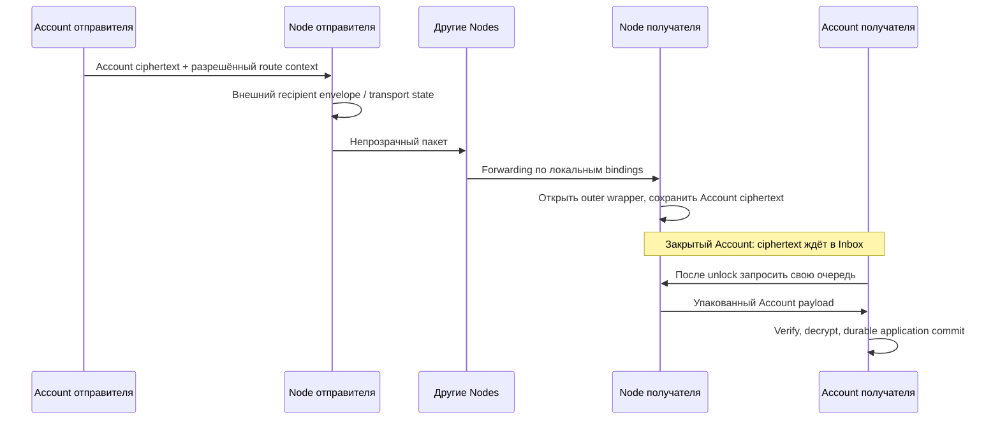

# Что уже реализовано: ключи, QR, маршруты и граница Account/Node

Срез кода: `transport-v3`, `9446c22f27309131456942870971d477f6f2358f`, 20 октября 2026. Это карта существующей реализации. Будущие изменения вынесены в [план](TELEGRAM_INTEGRATION_PLAN.md) и [сетевые алгоритмы](NETWORK_ALGORITHMS.md). Названия Device, Node и Account в разных поколениях кода не обозначают один ключ или одну сетевую роль.

## 1. Какие ключи откуда берутся

| Материал | Реальное происхождение и назначение | Чего из этого не следует |
|---|---|---|
| `DeviceRoot` | При первом создании случайные 32 байта; сохраняется обёрнутым ключом, полученным из master PIN через фактический legacy Argon2d profile (см. ниже). При unlock открывается тот же root | PIN не является seed идентичности. Ошибка unlock не разрешает создавать новую идентичность |
| Device signing/agreement | Из root через HKDF с разными доменами; соответственно Ed25519 и X25519 | Это не Account signing/box и не v4 Node signing |
| `DeviceRoot.transportIdentity(nodeId)` | Отдельный signing seed из root с контекстом проверенной Entry Node | Это migration DEVICE auth; не требование новой общей роли DEVICE |
| Account signing/box | Фактически Argon2d от `passphrase` (код намеревается вызвать Argon2id, но передаёт неверный enum) с salt `identity + 'D_MASH_GAMMA_V1_STABLE'`: time=3, mem=65536 KiB, hashLen=128; срезы 64..96 и 96..128 | «Из пароля» в коде означает также конкретную Account identity и параметры KDF. Account ID не является адресом транспорта |
| `Core.keys.pub_hex` | Account Ed25519 public + Account X25519 public + legacy installation Kyber public | Это составной bundle, **не DeviceRoot public key** |
| Legacy installation KEM | `DeviceRoot.deviceMaterial('ml-kem-768-v1')`, персистентный материал установки | Имя storage slot не доказывает соответствие ML-KEM. Общий KEM public может связывать legacy Accounts. Обладатель полного root и materials record может открыть и этот KEM secret; это не криптографически изолированный Account key store |
| V4 Account KEM | `AccountStaticKemV1`, отдельная запись в Account vault; profile `ACCOUNT_STATIC_LEGACY_KYBER768_V1` | Нельзя переносить замечание про общий legacy KEM на этот слой без отдельной проверки |
| V4 Node signing | Независимый случайный PoW seed в `node-ed25519-pow-v4`; Node ID — public Ed25519 key | Это не DeviceRoot agreement key и не Account ID. Node имеет стабильную wire identity |
| Private route authority/box | Отдельные ключи направленного маршрута из contributions в v3; независимые route/discovery/recipient keys и сертификаты в v4 | Направленность маршрутов не требует разных DeviceRoot для каждого собеседника |

Исходники: [DeviceRoot creation](https://github.com/Seriy615/D-MASH/blob/9446c22f27309131456942870971d477f6f2358f/D-MASH%20PWA/not_messenger/js/device_root.js#L541), [Device identity / transport context](https://github.com/Seriy615/D-MASH/blob/9446c22f27309131456942870971d477f6f2358f/D-MASH%20PWA/not_messenger/js/device_root.js#L365), [Account KDF и bundle](https://github.com/Seriy615/D-MASH/blob/9446c22f27309131456942870971d477f6f2358f/D-MASH%20PWA/not_messenger/js/core_engine.js#L341), [Account KEM](https://github.com/Seriy615/D-MASH/blob/9446c22f27309131456942870971d477f6f2358f/D-MASH%20PWA/not_messenger/js/account_static_kem_v1.js#L16), [Node identity](https://github.com/Seriy615/D-MASH/blob/9446c22f27309131456942870971d477f6f2358f/D-MASH%20PWA/not_messenger/js/node_identity.js#L51).

### Проверенное расхождение Argon2 type

`DeviceRoot._wrapKey` и `Core.boot` передают `type: argon2.argon2id`. У bundled vendor такого export нет: существует `ArgonType.Argon2id=2`, а верхний `argon2id` — undefined. Vendor при отсутствующем type выбирает **Argon2d**. Это подтверждено исполнением repository JS и WASM, а не только чтением комментариев: [check_actual_argon2.cjs](verification/check_actual_argon2.cjs), [результат и source hashes](verification/actual-argon2-results.json). Вектор с уменьшенными time/memory проверяет именно dispatch; это не повтор реального Account unlock. Поиск non-minified product JS не нашёл установки недостающего alias. В `node_admission_v4` enum выбирается иначе и явно; нельзя обобщать ошибку на каждый Argon2 вызов.

Следствия: labels `argon2id` и unit stubs с `argon2id:2` не доказывают фактический тип. Просто исправить enum глобально нельзя: сменятся root wrapping key и детерминированные Account signing/box keys. Исправление требует явного legacy profile, проверки реального vendor на fixed synthetic vectors, нового versioned wrap и rewrap того же root; Account derivation имеет отдельную совместимость. Ошибка типа сама по себе не доказывает взлом Argon2d. Быстрый SHA-256 PIN verifier — отдельная воспроизведённая проблема, которая позволяет обойти memory-hard стоимость при подборе PIN.

## 2. Что действительно лежит в QR

Нужно учитывать загруженные wrappers, а не только базовый `Core.showMyQR`. [release.js:5](https://github.com/Seriy615/D-MASH/blob/9446c22f27309131456942870971d477f6f2358f/D-MASH%20PWA/not_messenger/js/release.js#L5) по умолчанию выбирает `legacy-migration`; `managed-v4` включается явно.

| Путь | Содержимое | Проверяемая привязка |
|---|---|---|
| Legacy PRIVATE | `DMASH_PAIRING_V1 {version:1,user_id:AccountSigningPublic,contribution}` | Локальный contact/pairing flow; это не подписанный DeviceRoot invite |
| Legacy PUBLIC | Contact URI с `{v:1,r:routeId,c:RouteCertificate}` | Route authority из сертификата; Account ID прямо не включён |
| Managed-v4 PRIVATE | `DMASH_PAIRING_V2`: Account signing/box/KEM public, contribution, intended_peer, generation/expiry, inbound certificate, Account signature | `expectedPeer` проверяется против `account_keys.signing`; сертификат отдельно проверяет route authority |
| Managed-v4 public account bootstrap | После разрешённого запроса формируется Account-signed V2 bundle с inbound certificate | Public registration/discovery и Account handshake имеют разные владельцы; это не тот же legacy PUBLIC URI |

В managed-v4 `dmash://private-v4/z1/...` — deflate + base64url bundle. Сжатие не шифрует его содержимое. Приватные DeviceRoot/Account ключи в этих форматах не экспортируются; contribution требует отдельного обращения как с capability material.

Исходники: [PUBLIC URI / PRIVATE payload](https://github.com/Seriy615/D-MASH/blob/9446c22f27309131456942870971d477f6f2358f/D-MASH%20PWA/not_messenger/js/acceptance_fixes.js#L51), [фактический PRIVATE/PUBLIC renderer](https://github.com/Seriy615/D-MASH/blob/9446c22f27309131456942870971d477f6f2358f/D-MASH%20PWA/not_messenger/js/acceptance_fixes.js#L174), [managed UI override](https://github.com/Seriy615/D-MASH/blob/9446c22f27309131456942870971d477f6f2358f/D-MASH%20PWA/not_messenger/js/node_account_ui_v4.js#L104), [создание V2 bundle](https://github.com/Seriy615/D-MASH/blob/9446c22f27309131456942870971d477f6f2358f/D-MASH%20PWA/not_messenger/js/public_account_orchestrator_v4.js#L48), [expectedPeer verification](https://github.com/Seriy615/D-MASH/blob/9446c22f27309131456942870971d477f6f2358f/D-MASH%20PWA/not_messenger/js/account_pairing_v2.js#L48), [упаковка ссылки](https://github.com/Seriy615/D-MASH/blob/9446c22f27309131456942870971d477f6f2358f/D-MASH%20PWA/not_messenger/js/account_private_pairing_link_v4.js#L3).

Уточнение пользователя «один публичный ключ устройства, не публикуемый в сети» фиксируем отдельно от этих форматов. В коде есть постоянные DeviceRoot keys, но текущий PRIVATE QR нельзя описывать как QR только с этим ключом. Подмена Account bundle новым Device invite — самостоятельное versioned изменение, а не исправление названия. В плане сохраняются действующие identities и явно разделяются provisioning маршрута и Account contact. Вопрос, нужен ли дополнительный device-only invite, оставлен в backlog с требованием конкретной схемы и совместимости.

## 3. Направленные v3 маршруты уже существуют

`PrivateRoutesV3.pair(a,b,generation)` принимает две разные 32-byte contributions в hex и целое безопасное `generation >= 1`. Account ID в аргументах нет.

```text
ikm = concat(sort(a, b))
routingRoot = HKDF(ikm, zeroSalt32, "D-MASH|ROUTING_ROOT|V1", 32)
signSeed(direction) = HKDF(routingRoot, zeroSalt32,
    "D-MASH|PRIVATE-ROUTE-AUTHORITY|V3|" + direction + "|" + generation, 32)
boxSeed(direction) = HKDF(routingRoot, zeroSalt32,
    "D-MASH|PRIVATE-ROUTE-DEVICE-BOX|V3|" + direction + "|" + generation, 32)
routeId(direction) = SHA256("D-MASH|PRIVATE-LOCATOR|V3\0" + signingPublic(direction))
```

Для стороны с меньшей contribution outgoing=`A_TO_B`, incoming=`B_TO_A`; у другой стороны наоборот. Поэтому `A.outgoing == B.incoming`, а противоположные направления различаются. Другой peer contribution даёт другое pair material. При reconnect не требуется менять ID. Generation разделяет материал, но сама функция не хранит antirollback floor: это обязанность владельца состояния.

`ensurePairingContribution()` сохраняет contribution в Account vault под `pairing_material/self`. Она **не обязательно новая для каждого QR или контакта**, несмотря на надпись `pair-specific` в текущем renderer. Сочетание двух contributions даёт пару маршрутов; сама одна сохранённая contribution может повторяться в нескольких приглашениях.

Важно для модели угроз: это не DH. Любой, получивший **обе** contributions, способен воспроизвести signing/box secrets обоих направлений. Одна сторона пары также знает оба направления. Route signing key удостоверяет authority capability, а не исключительное владение физическим устройством или Account. Захват обеих QR может скомпрометировать маршрутизацию/внешний envelope; внутреннее Account E2EE проверяется отдельно. Такой предел нельзя исправить одним новым именем route ID.

Исходники: [полная функция pair](https://github.com/Seriy615/D-MASH/blob/9446c22f27309131456942870971d477f6f2358f/D-MASH%20PWA/not_messenger/js/private_routes_v3.js#L7), [сохранение contribution](https://github.com/Seriy615/D-MASH/blob/9446c22f27309131456942870971d477f6f2358f/D-MASH%20PWA/not_messenger/js/core_engine.js#L465), [передача route material устройству](https://github.com/Seriy615/D-MASH/blob/9446c22f27309131456942870971d477f6f2358f/D-MASH%20PWA/not_messenger/js/core_engine.js#L518).

V4 нельзя выдавать за тот же KDF: [orchestrator:50](https://github.com/Seriy615/D-MASH/blob/9446c22f27309131456942870971d477f6f2358f/D-MASH%20PWA/not_messenger/js/public_account_orchestrator_v4.js#L50) создаёт независимые `route`, `discovery_sign`, `discovery_box`, `recipient_box`; `route_id` — public route signing key. Переход v3→v4 требует аутентифицированного переноса ownership/bindings, не пересчёта всех ID через одну новую формулу.

## 4. Где кончается Account и начинается устройство



В v3 `installPrivateRouteV3` требует Account **при установке**, сохраняет incoming signing/box secrets и blind Account slot в DeviceInbox, outgoing box public — в отдельной записи. После этого probe запускается отдельно от Account lifecycle lock. Это готовый шов для native provisioning, но не доказательство полностью автономного native transport outbox.

`DeviceEnvelope.seal` использует **route box public key**, новый ephemeral X25519 keypair и nonce. Wire содержит `{v,e,n,c}`; постоянный recipient public key туда не включается. Получатель сначала пробует public/private route keys; `Core.device.agreement.secretKey` — последний legacy fallback, а не основной recipient key private routes. Сам outer box не удостоверяет Account отправителя: любой обладатель public recipient key может его сформировать.

`DeviceInbox.receive` открывает outer wrapper, заменяет route на локальный blind alias и записывает opaque `account_payload` **до** обработчика Account. Закрытый или другой Account оставляет ciphertext для последующей обработки. Внутренний sender proof/decrypt выполняет Account.

V4 materialize берёт `remoteCertificate.recipient_box` и сохраняет стабильный sealed operation. `NodeInboxV4.receive` сохраняет либо ещё закрытый wrapper как `deferred`, либо открытый outer payload как `pending`; это всё ещё Account ciphertext. Нельзя считать открытие recipient wrapper расшифровкой пользовательского сообщения.

Исходники: [route provisioning](https://github.com/Seriy615/D-MASH/blob/9446c22f27309131456942870971d477f6f2358f/D-MASH%20PWA/not_messenger/js/node_manager.js#L927), [выбор outgoing route box](https://github.com/Seriy615/D-MASH/blob/9446c22f27309131456942870971d477f6f2358f/D-MASH%20PWA/not_messenger/js/node_manager.js#L855), [outer envelope](https://github.com/Seriy615/D-MASH/blob/9446c22f27309131456942870971d477f6f2358f/D-MASH%20PWA/not_messenger/js/device_envelope.js#L25), [перебор recipient keys / fallback](https://github.com/Seriy615/D-MASH/blob/9446c22f27309131456942870971d477f6f2358f/D-MASH%20PWA/not_messenger/js/node_manager.js#L987), [persist перед Account](https://github.com/Seriy615/D-MASH/blob/9446c22f27309131456942870971d477f6f2358f/D-MASH%20PWA/not_messenger/js/device_inbox.js#L172), [Account verify/decrypt](https://github.com/Seriy615/D-MASH/blob/9446c22f27309131456942870971d477f6f2358f/D-MASH%20PWA/not_messenger/js/core_engine.js#L1544), [sealed v4 operation](https://github.com/Seriy615/D-MASH/blob/9446c22f27309131456942870971d477f6f2358f/D-MASH%20PWA/not_messenger/js/account_sealed_operation_v4.js#L47), [deferred Inbox](https://github.com/Seriy615/D-MASH/blob/9446c22f27309131456942870971d477f6f2358f/D-MASH%20PWA/not_messenger/js/node_inbox_v4.js#L128).

## 5. Какая идентификация всё же видна в сети

Непубликация **DeviceRoot agreement public key** в outer envelope не означает отсутствие любого постоянного ключа на wire. Node handshake [HELLO](https://github.com/Seriy615/D-MASH/blob/9446c22f27309131456942870971d477f6f2358f/D-MASH/client/backend/secure_session.py#L123) передаёт Node signing `public_key`. Route certificates также содержат соответствующие route public keys. Это разные области идентификации.

Пользователь уточнил локальность **направленных маршрутов**. Из этого не выводим новое требование заменить Node signing identity ключами на каждую пару. При этом нынешняя Node identity позволяет сопоставлять её подключения соседям. Путь в native daemon сам по себе не убирает IP/timing/размеры и совпадающий ciphertext у сговорившихся Nodes.

## 6. Что переносить, а что ещё предстоит реализовать

| Уже есть в коде | Требуемая работа |
|---|---|
| Root/Account separation; route keys и blind local slot; opaque Inbox | Перенести ownership и storage в службу, убрать доступ к Account globals из сетевого исполнения |
| JS Worker и Python Node interop, real foreign transit | Native headless host, supervision, process isolation/IPC и OS lifecycle |
| Account durable outbox, materialized sealed operation, receipts | После Account handoff единственный durable transport job, который не нуждается в Account retry callback |
| V4 relationships/discovery/hop labels | Непрерывный supervisor, bounded neighbor discovery, mobility и несколько bootstrap paths |
| ICE/WebRTC media в отдельных путях | Authenticated native direct carrier и policy-controlled fallback; direct между любыми NAT не гарантируется |
| Foundation v4 mailbox | Подключить ownership/admission/replay/retention к runtime. Сейчас `node_mailbox_v4.py` прямо inactive |
| Текущая file runtime / encrypted local vault | Отдельный bounded bulk protocol, chunk resume и удалённые временные encrypted buffers; managed-v4 media пока выключены |

Native transport boundary должен повторять полезный шов `NodeRuntimeHostV4.startMaterials`: сетевой процесс получает только Node seed, storage key, BaseNCRH и разрешённые route keys, а не весь DeviceRoot/PIN или произвольный доступ к `deviceMaterial(name)`. Root/credential broker остаётся вне сетевого процесса. Иначе legacy root-backed Kyber secret тоже доступен holder полного root, хотя классические Account private keys из Account password ему от этого не становятся известны. Managed-v4 Account KEM лежит в Account-master-key vault. Это предел текущего root-backed хранения и требование к native isolation, не разрешение стирать legacy KEM без inventory/ownership migration. [Фактический Worker handoff](https://github.com/Seriy615/D-MASH/blob/9446c22f27309131456942870971d477f6f2358f/D-MASH%20PWA/not_messenger/js/node_runtime_host_v4.js#L8) не передаёт полный root в Worker, но native process/IPC broker ещё не реализован.

Account logout должен оставлять **уже переданные** ciphertext jobs; он не даёт daemon права создавать новые Account подписи, шифровать новое сообщение или завершать Account handshake. Пока нужен новый Account crypto step, соответствующая операция ждёт unlock, а Node/transit продолжают работать. Custody/Inbox acceptance не выдаётся за Account DELIVERED/READ.

Это исходная база для проектирования. Проверки модулей и модели сбоев перечислены в [verification/README.md](verification/README.md); они не являются реализацией daemon, проверкой реальных NAT или полным криптографическим аудитом.
