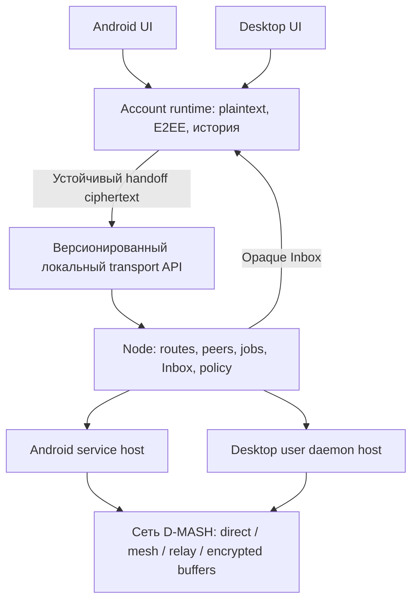

# Android и Desktop D-MASH: общий daemon и интерфейсы с компонентами Telegram

20 октября 2026. Исходная база: `transport-v3`, `9446c22f27309131456942870971d477f6f2358f`. **Это план, а не готовые native клиенты.** Пользователь подтвердил конечный результат: работающее приложение с устранением найденных уязвимостей; **Android и Desktop разрабатываются одновременно**. Приоритеты и проверяемый остаток — [IMPLEMENTATION_BACKLOG.md](IMPLEMENTATION_BACKLOG.md).

## Решение

Один сетевой контракт и переносимая логика Node, два platform host и два обычных UI. Сначала на обеих платформах самостоятельная служба с небольшим status UI; затем чаты и выбранные компоненты Telegram. Account работает с plaintext/E2EE и своей историей. Демон принимает подготовленные ciphertext packets, независимо держит соединения, ищет пути, повторяет передачу и хранит encrypted Inbox/очередь. Закрытый Account не нужен для уже принятого сетевого задания.

Сохраняем действующие DeviceRoot, Account/Node identities, историю, направленные route authorities и формат получательского envelope на поддержанных compatibility paths. Не заменяем их придуманной схемой per-peer Device IDs. Точные различия legacy/v4 и форматов QR зафиксированы в [CURRENT_IMPLEMENTATION.md](CURRENT_IMPLEMENTATION.md). Обнаруженные риски не считаются закрытыми от переноса кода в другой процесс.



На конкретном устройстве работает один Node owner; diagram показывает общий контракт, а не общую память двух платформ. Account runtime находится вне сетевого daemon. Account keys не входят в daemon memory/API. У UI есть application API и scoped transport capabilities; произвольный Node Worker RPC ему не выдаётся. Полным DeviceRoot и legacy root-backed KEM material владеет локальный credential/root broker **вне сетевого процесса**. Native daemon получает только scoped Node seed/storage key/BaseNCRH и разрешённые route secrets — по существующему шву `NodeRuntimeHostV4.startMaterials`. Он не получает master PIN, весь root, Account vault key или произвольный `deviceMaterial(name)` API. В legacy shared installation KEM доступен полному root holder; не обещаем изоляцию этого KEM при root compromise и не стираем его без ownership inventory. Managed-v4 Account KEM остаётся под Account master key.

Закрытие UI может очищать broker root, сохраняя разрешённый transport bundle в daemon; полный D-MASH root lock отзывает bundle и останавливает Node. Reboot/autostart требует отдельного OS-wrapped transport bundle и разрешённой политики, не сохранения полного root для unattended сетевого процесса. Такая process/API граница не объявляется защитой от произвольного same-UID/native-code/OS compromise. Независимый root lock закрывает Node keys/connections; Account logout закрывает только Account. Screen off/keyguard/Activity recreation не означают root lock.

## Как использовать уже написанный код

Есть две реализации сетевых алгоритмов: Python Node и JS Node Worker. Account преимущественно JS/IndexedDB/WebCrypto/WASM, местами связан с DOM и глобальными Core/Storage. Поэтому Python Node не является всем messenger core, а hidden WebView не решает lifecycle сети.

Базовый путь — извлечь существующую headless Node логику и заменить platform ports: криптография/RNG, транзакционное storage, sockets/network change, timers/cancellation, root wrapping и supervision. Пакетирование общей логики выбирает ранний исполняемый spike на Android **и** Desktop; анализ [native host](verification/NATIVE_HOST_FEASIBILITY.md) фиксирует измеренное решение и ограничения. До такого proof нельзя утверждать, что QuickJS/Node.js/Python автоматически предоставляют недостающие Web APIs или безопасный Android service.

Spike сравнивает reuse JS Node modules в headless engine с переносом сетевого контракта в portable native library. Принимается один общий runtime по результатам: настоящий NODE/WSS handshake/transit с существующей Python Node, encrypted transaction+restart, отсутствие DOM/Account dependence, воспроизводимые desktop executable и Android service build, CPU/memory footprint. Если вариант требует переписать Account crypto или тянуть browser runtime ради одного socket, он не проходит. Наличие только Desktop prototype не закрывает общий выбор.

## Что переносим из Telegram

Исходники для оценки закреплены: Android `68c6775ac373f4bdb30ae9986282dd5ec0407756`, Desktop `351204f3695b4a39bc3f4d2f230c061b9a01fe2a`. Сборки этих клиентов пока **NOT RUN**.

| Часть | Проверенная связь | Порядок переноса |
|---|---|---|
| Android `TextSettingsCell` | AndroidUtilities, LocaleController, Theme, AnimatedTextView/RLottie/BackupImageView | Первый кандидат: layout/text/divider/loading части настроек, адаптированные к D-MASH policy DTO; не копировать весь messenger package |
| Android `ChatMessageCell` / `ChatActivity` | MessageObject/TLRPC, MessagesController, FileLoader/ImageLoader, Telegram storage | После своего message/contact viewmodel: выборочно paint/layout/gesture, с явным dependency inventory; полный экран не является готовым независимым widget |
| Desktop `HistoryView::Element` | HistoryItem/PeerData; HistoryItem принимает MTP types | Извлечь нужные rendering/layout части в собственный Qt viewmodel; Main::Session и MTProto не становятся runtime приложения |
| Навигация, меню, composer, progress | Каждый компонент отдельно проверяется на зависимости/controllers | Подключать по одному; неактивные Telegram функции не отображать как рабочие |

Первичные исходники: [TextSettingsCell](https://github.com/DrKLO/Telegram/blob/68c6775ac373f4bdb30ae9986282dd5ec0407756/TMessagesProj/src/main/java/org/telegram/ui/Cells/TextSettingsCell.java), [ChatMessageCell](https://github.com/DrKLO/Telegram/blob/68c6775ac373f4bdb30ae9986282dd5ec0407756/TMessagesProj/src/main/java/org/telegram/ui/Cells/ChatMessageCell.java), [MessageObject](https://github.com/DrKLO/Telegram/blob/68c6775ac373f4bdb30ae9986282dd5ec0407756/TMessagesProj/src/main/java/org/telegram/messenger/MessageObject.java), [Desktop History element](https://github.com/telegramdesktop/tdesktop/blob/351204f3695b4a39bc3f4d2f230c061b9a01fe2a/Telegram/SourceFiles/history/view/history_view_element.h), [Main session](https://github.com/telegramdesktop/tdesktop/blob/351204f3695b4a39bc3f4d2f230c061b9a01fe2a/Telegram/SourceFiles/main/main_session.h).

Это D-MASH clients: transport/account/history модели наши. Telegram login, API/DC discovery, MTProto, Telegram SQLite/sync counters в новый runtime не входят. Любой заимствованный код и ресурсы имеют записанное происхождение. Перед выпуском egress/DNS на всех flows подтверждает отсутствие незапрошенных обращений к Telegram API/CDN/analytics; optional notification integrations включаются отдельно.

## Минимальные API и состояния

Сетевой API одинаков на платформах; Unix socket/OS peer credentials на Desktop и проверенный Binder/platform IPC на Android реализуют scoped capabilities, schema bounds и revocation. Не открывать всем приложениям локальный HTTP control port.

```text
rootBroker.unlock(credentials) -> scopedTransportBundle
node.start(scopedTransportBundle) / rootBroker.fullLock()
node.status() / node.events(cursor)
node.installDestination(ownerCapability, versionedRouteMaterial) -> DestinationHandle
node.submit(callerCapability, destination, operationId, packedCiphertext) -> JobHandle
node.query(job) / node.cancel(job)
node.readInbox(ownerCapability, cursor) -> opaque records
node.commitConsumption(recordHandle, applicationCommitToken)
node.applyPolicy(expectedRevision, policy) -> committedRevision
```

`submit` возвращает durable success только после собственной устойчивой копии bytes и транзакционного job index. Повтор того же caller/destination/operation/digest идемпотентен; другой digest с тем же ключом — conflict. Нет IP/PoW/manual route decisions в Account send API. Файловое staging добавляет durable ciphertext dependencies; его алгоритм — [BUFFERED_FILES.md](BUFFERED_FILES.md).

Application API отдельно: Account unlock/logout, inspect/create invite, contact acceptance, history/page/search, draft/send, verified receipts. Account готовит E2EE frame и handed-off job. Новый Account handshake/rekey требует Account unlock; демон сохраняет соответствующий opaque inbound control до этого момента. Даже без разблокированных Accounts Node может делать foreign transit.

Пользовательские статусы:

- «Подготавливается» — Account ещё не выполнил E2EE/staging; transport job не принят.
- «В очереди» — daemon durably принял пакет; UI/Account можно закрыть.
- «Сохранено на узлах до …» — проверены требуемые custody receipts; это ещё не доставка Account.
- «Доставлено» — Account проверил authenticated recipient receipt после decrypt/verify/durable commit.
- «Прочитано» — отдельный E2EE receipt при разрешённой пользователем политике.
- «Ждёт сеть/разрешённый путь/разблокировку» и expiry/quota/unsupported имеют конкретную причину, без необходимости заново вручную обмениваться ключами.

## Параллельные этапы

| Этап | Общая работа | Android | Desktop | Критерий перехода |
|---|---|---|---|---|
| 0. Security baseline и контракт | Reproduce/fix P1 verifier, зависимости, identity/QR/ownership spec, retained synthetic fixtures | Build environment + packaging spike | Build environment + packaging spike | Зафиксированы source SHA, initial FAIL/PASS, никакого reset identities |
| 1. Первый daemon | Headless Node ports, single owner, durable jobs/Inbox, WSS supervisor и root lock | Service lifecycle + minimal status UI | User daemon + minimal status UI | UI закрыт, Account закрыт: реальный transit и retry; crash/restart сохраняет identity/queue на каждой платформе |
| 2. Account facade | Authenticated provisioning, local handoff, history/receipts, current-state migration | Native contact/text client | Native contact/text client | Android↔Desktop↔reference совместимы; Account keys отсутствуют в daemon; повтор не дублирует commit |
| 3. Self-organization и NAT | Bounded introductions/peers, route alternatives, authenticated ICE/direct, policy fallback | Mobile network changes/Doze | Listener/carrier/network changes | Реальные разные NAT + forced relay + mobility + запрет direct во время retry |
| 4. Buffered files | Negotiated durable custody, blob providers/resume/locator, no sender Account callback | File picker/progress/offline retrieval | File picker/progress/offline retrieval | Sender offline после принятой custody; recipient later retrieves/verifies; bounded quota/TTL, потеря provider не теряет ещё доступные copies |
| 5. Обычный UI | Стабильные DTO/capabilities, выбранные Telegram компоненты, granular policies | Chats/settings/accessibility/notifications | Qt chats/settings/accessibility/notifications | Все видимые controls и error/loading/cancel реально проверены; UI attach не создаёт новую Node |
| 6. Release hardening | Threat model, независимый crypto/security review, dependency provenance, full migration/backup/rollback, supported calls/media | Signed reproducible build; real devices | Reproducible package; supported desktop OS | Exact-source full acceptance по каждой платформе, известные release blockers закрыты, пределы гарантии опубликованы |

UI разработка идёт параллельно на стабильном facade после daemon gate; у каждой платформы собственная приёмка. Успех одной платформы не означает готовность второй. Завершение PWA целиком не является предварительным этапом. Существующие N0–N8/A–M/E6 остаются матрицей совместимых требований; этот план меняет host/приоритеты, а не засчитывает старый полный DONE.

## Android lifecycle — ранний обязательный gate

FGS нужен для заметной пользователю работы. Для background `dataSync`/`mediaProcessing` при target Android15+ действуют отдельные лимиты 6 часов/24 часа; это не бессрочный mesh runtime. Service type выбирается по реальной функции, с необходимыми permission/notification и проверкой условий запуска. Пригодность конкретного типа для данного Node ещё не доказана. [FGS types](https://developer.android.com/develop/background-work/services/fgs/service-types), [timeout rules](https://developer.android.com/develop/background-work/services/fgs/timeout).

Живой process/FGS не доказывает доступность сети в Doze. Валидация включает физический телефон: screen off, Doze, ограниченная батарея, Wi-Fi↔mobile, reboot, user force-stop, потерянные permissions. Когда ОС останавливает работу, peers получают unavailable/recovery, очередь остаётся ciphertext. Нельзя обещать безусловный круглосуточный transit; допустимое background окно фиксируется по evidence. [Doze](https://developer.android.com/training/monitoring-device-state/doze-standby).

Desktop user daemon также учитывает sleep/OS logout/доступность keystore. Process lock, durable owner generation и fencing запрещают второму UI/старому процессу писать или отправлять с теми же keys. Формат events позволяет UI восстановиться по cursor после reconnect.

## Простота и гибкость

Обычный flow: открыть Account → один раз подтвердить контакт → писать или выбрать файл. По умолчанию runtime сам управляет network paths/retries/providers, показывает проверенные состояния. В настройках отдельно доступны direct/relay, transit, storage чужих ciphertext, Wi-Fi/mobile/roaming, батарея, лимиты диска/CPU/bytes, TTL/replicas, file auto/direct/buffered/resume/auto-download и lock/notification policy. Presets только начальные значения; индивидуальные настройки не спрятаны. Обязательных вопросов на каждую отправку нет. Полная матрица и поведение уже принятых jobs — [SECURITY_CONTROLS.md](SECURITY_CONTROLS.md).

Нельзя выключить integrity/authentication/replay guard, сохранив обещание того же протокола. Можно менять поддержанные политики безопасности и явно видеть их цену: direct раскрывает endpoints, relay имеет свои metadata, раннее удаление local spool уменьшает доступность, короткий PIN остаётся слабым даже после исправления fast verifier.

## Лицензии и границы обещаний

Самостоятельный D-MASH core планируется MIT с корректными LICENSE/provenance/notices. Клиенты с заимствованным GPL кодом сохраняют соответствующие обязательства: Android GPLv2-or-later, Desktop GPLv3-or-later с указанным OpenSSL exception. Разделение IPC не перекрашивает чужой код в MIT. Брендинг/ресурсы проверяются отдельно. [Android header](https://github.com/DrKLO/Telegram/blob/68c6775ac373f4bdb30ae9986282dd5ec0407756/TMessagesProj/src/main/java/org/telegram/ui/Cells/ChatMessageCell.java), [Desktop LEGAL](https://github.com/telegramdesktop/tdesktop/blob/351204f3695b4a39bc3f4d2f230c061b9a01fe2a/LEGAL).

«Все дыры закрыты» не является проверяемым сертификатом отсутствия неизвестных ошибок. Проверяемый release gate: каждая выявленная уязвимость имеет воспроизведение, исправление и retest; критические незакрытые риски блокируют release; независимый review, compromise/failure tests и модель угроз описывают остаточные свойства. Full implementation documentation + formal threat model выполняются отдельным артефактом по actual implementation, до security release. Новую ratchet/identity crypto не изобретаем по ходу переноса UI и не обещаем недоказанные PFS/PCS/PQ/анонимность.

Текущая проверка модулей и bounded spec model приведена в [verification/README.md](verification/README.md), независимый review — [INDEPENDENT_REVIEW.md](INDEPENDENT_REVIEW.md). Реальные native builds/lifecycle/NAT gates в этом плановом срезе не выполнены. Сроки разработки выводятся из первого сквозного daemon slice и измерений, а не из количества экранов Telegram.
