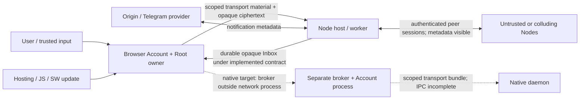

# D-MASH current threat model — 20 October 2026

This model covers committed implementation checkpoint **`d123325`**, credential
caller integration **`d8eff7d`**, its instruction correction **`3541458`**, and
unchanged transport/Account code inherited from **`9446c22`**. It supplements
the frozen [implementation map](../../audits/2026-10-20/CURRENT_IMPLEMENTATION.md)
and [repository audit](../../audits/2026-10-20/REPOSITORY_AUDIT.md), with current
changes in [CURRENT_IMPLEMENTATION_DELTA.md](CURRENT_IMPLEMENTATION_DELTA.md).
Later integrated native boundaries through `3a72492` and source-verification
followup `0b804bf` are described in the current delta and the bounded native
section below. Uncommitted fork integration has no runtime acceptance.
[Exact source and evidence hashes](THREAT_MODEL_SOURCES.json) identify the
original 24 referenced source files, subsequent source snapshots and bounded
verification artifacts inspected.

**Current** means present in the referenced code; test evidence has its stated
scope. **Target** means required design or incomplete integration. **NOT RUN**
means a property has not received the stated environment/fault acceptance.
None means every attack is prevented. Android/Windows/Linux apps and the full
implementation goal remain open; no production deployment was performed.

## Native checkpoint: implemented boundaries and current limits

The original model below remains pinned to its stated source. Later native
implementation through `3a72492` has independently checked Linux process and
transport behavior, described in the [current implementation delta](CURRENT_IMPLEMENTATION_DELTA.md#native-application-checkpoint-after-the-frozen-baseline).

- The resident credential owner holds the unlocked local Root and Account worker.
  Node receives only scoped Node seeds/storage/route transport material through a
  private inherited channel. Account E2EE keys and plaintext are outside Node.
  This is a practical process/lifetime boundary; same-user OS compromise is not
  prevented. Android/Windows enforcement still requires actual platform acceptance.
- Local owner authorization is distinct from Account payload authentication.
  An Account signs a Node ownership challenge; route preparation is checked
  against its signed journal, journal commit receipt precedes activation, and
  only the matching live preparation becomes active. Route capabilities allow
  their scoped transport actions; they are not the Account's message-decryption keys.
- Node persists opaque queued packets independently of the Account. Account
  decrypts/verifies and durably commits history before Inbox consumption. Root's
  actual recipient crash at this boundary confirms one application row across
  replay/reopen for the tested text operation. It does not prove every handshake,
  ratchet, migration or file crash transition.
- Account logout preserves unlocked Node; full Root lock currently stops it.
  Transport-only pause preserves queued work and resumes without PIN; the
  [process/crash proof](root-native-pause-process.json) is scoped to Linux.
  Actual fork controls and OS lifecycle remain open. Private lease extension keeps a live owner context; rotating
  MintCapability deliberately revokes its old context and must not be substituted.
- The plaintext check in the remote E2EE proof scans Node profile files only.
  Metadata, ciphertext sizes, route availability and process memory have their
  existing limits. It is not a proof of anonymity, PFS/PCS/PQ or complete erasure.

Corrected unclean host recoverya52e9f5 now independently passes process/crash
and ACTIVE grant renewal gates, with unchanged identities/history. Original405
first-enable failure remains an unexplained responsiveness observation; the
diagnostic-only successor PASS does not establish its cause. Android scoped
service installation and full Desktop Node-control UI still time out. These
availability blockers do not justify resetting accepted identities/history.
No production runtime or user data was changed by these native checks.

The selected UI is now the actual GPL Telegram Desktop/Android code, with
D-MASH Account/Node adapters. It adds a large endpoint parsing/rendering and
dependency surface to the trusted client. Telegram numeric peer/message IDs are
local presentation projections; they must not become global transport identities.
The independent Account encrypted store remains authoritative. Fork patches
currently disable Telegram backend calls and use memory-only presentation caches;
full-app execution and no-egress acceptance have not proved those boundaries.
Upstream auto-update must stay disabled in the D-MASH build, so an upstream binary
cannot replace the adapted application. GPL source/notices remain distributable.

Fresh signed private pairing and Account-owned encrypted pending sends now have
[independent process/network proof](root-native-first-send.json), including a
host crash and automatic retry without caller resending. Accepting pending work
only means local durable acceptance. UI clocks, delivery and read marks must
follow actual Account state/receipts; native/Node acceptance is not remote READ.
Public contact IPC, full N4, phone NAT and file-provider custody remain open.

## Assets, owners and trusted computing base

| Asset | Current owner / protection | Main exposure or loss consequence |
| --- | --- | --- |
| Message/file plaintext, history, Account credentials | Account Core/vault and active UI; encrypted local stores with Account/session guards | Endpoint execution, unlocked memory, plaintext export or malicious preview can disclose content. |
| DeviceRoot, local master/wipe credentials | DeviceRoot/local credential service; random 32-byte Root, versioned encrypted wrap, prepared handles, worker KDF, IDB CAS | Root compromise exposes installation material; short numeric master remains an offline guessing target. Wipe credential authorizes destruction, not reading. |
| Account signing/box/session keys | Account derivation/vault/session owner | Impersonation/decryption and accepted receipts; Account identity secret alone does not reconstruct random Root, history or all KEM/session state. |
| Legacy installation KEM / managed Account KEM | Legacy DeviceRoot material versus separate AccountStaticKemV1 vault entry | Legacy full Root holder can open installation KEM; common public material can correlate legacy Accounts. |
| Node seed, storage key, directional relationships, scoped route keys | Current Node host/worker and Python stores | Peer impersonation, route access, durable transport state exposure and availability loss. These are not Account content keys. |
| Pairing contributions, route authority, mailbox/resource capabilities | Contact/route setup and authorized Node owner | Unauthorized route creation/access, injection or queue depletion; v3 contributions are capability material. |
| Encrypted Inbox/outbox, accepted file data and receipts | Account local delivery plus Node transport state according to each implemented profile | Loss, duplication, replay, false UI delivery, disk exhaustion or disclosure of metadata. |
| Bot tokens, webhook secrets, notification bindings | Separate Origin service/vault and Telegram provider | Notification impersonation, account-link metadata disclosure, spam and availability loss. |
| Updates, dependencies, backups, policies | Hosting/operator, packaging/install tooling, user-selected policy and OS | A malicious update or same-user attacker can cross every browser key boundary; stale restore can roll back availability/revocation state. |

The browser's trusted computing base includes same-origin HTML/JS/WASM, Service
Worker, bundled dependencies, browser/WebCrypto/IndexedDB, extension/OS policy
and the endpoint while unlocked. Worker separation is a useful API/lifetime
boundary; it is not a sandbox against arbitrary malicious same-origin code.
The Python trust base additionally includes service account permissions, state
directories, interpreter/dependencies, TLS/proxy configuration and host OS.

The native **target** narrows the network process to scoped Node transport
materials, through a credential/root broker and separate Account/UI lifetime.
The browser [host seam](../../../D-MASH%20PWA/not_messenger/js/node_runtime_host_v4.js)
already has `startMaterials`; native
[TransportBundle](../../../native/src/transport_bundle.h) rejects foreign fields
and owns transport byte arrays. Authenticated local IPC, peer credentials/ACL,
message-size bounds, service packaging and OS key wrapping remain unfinished.
Same-UID/native RCE resistance is not established by a struct or process diagram.
Later headless Linux actor/Inbox integration has scoped native test and local
Python-peer evidence; the broker/IPC/native UI boundary is still incomplete.

## Adversaries and boundaries

### Network observers and malicious/colluding Nodes

**Current:** Node secure sessions authenticate peer keys, bind transcripts,
derive directional keys and enforce sequence/replay checks; admission/PoW,
resource grants, direction, expiry and size bounds constrain authorized work.
Node identity is independent of Account identity. Route/hop labels and blind
local Account slots reduce direct address disclosure. Sources:
[secure session](../../../D-MASH/client/backend/secure_session.py),
[v4 registration](../../../D-MASH/client/backend/node_registration_v4.py),
[relationships](../../../D-MASH%20PWA/not_messenger/js/node_relationships_v4.js),
[routing](../../../D-MASH/client/backend/node_routing_v4.py).

**Residual:** peer authentication proves possession of a pinned/provisioned
key, not honesty or independence. Nodes can delay, drop, censor or lie about
retention. A stable Node signing key is transmitted in handshake and correlates
connections. Route certificates expose their own public keys. IP, timing,
packet length, availability and repeated unchanged ciphertext remain visible;
colluding hops can correlate payload even when hop labels change. PoW does not
prove one person/device or prevent all Sybil/eclipsing attacks. A catalog with
one default pinned Node does not establish multi-peer failover or transit.

**Target / NOT RUN:** continuous managed-v4 supervision, independent peers,
complete reconciliation on mobility and crash, real NAT/direct/relay policy
acceptance. No endpoint anonymity, traffic-analysis resistance or protection
from a global observer is claimed. DHT, cover traffic and an invented identity
scheme are not supplied by this model. Local Worker transit evidence in the
frozen audit is useful scoped history, not proof of current native operation.

### Pairing/QR capture and contact substitution

**Current:** legacy PRIVATE QR contains Account signing public and a contribution;
PUBLIC URI contains route/certificate information. Managed V2 adds Account
signing/box/KEM public, intended peer, generation/expiry, route certificate and
Account signature; compressed links are encoded, not encrypted. Formats and
effective renderer sources are mapped in the
[frozen QR section](../../audits/2026-10-20/CURRENT_IMPLEMENTATION.md#2-что-действительно-лежит-в-qr).

`PrivateRoutesV3.pair(a,b,generation)` derives both directional route key sets
from sorted contributions, uses no AccountID argument and validates a safe
positive generation. A→B matches B's incoming material and differs from B→A;
a third peer contribution isolates that pair. The existing per-Account self
contribution may be reused across contacts. It is **not DH**: an observer who
captures both contributions derives both route signing/box secrets. A pair
participant also knows both directions. The function alone does not persist an
antirollback generation floor. Source:
[private_routes_v3](../../../D-MASH%20PWA/not_messenger/js/private_routes_v3.js).

**Residual:** signatures validate the included key and binding; first-contact
human identity still depends on an authenticated QR/link exchange and expected
peer check. Leaked capabilities permit their scoped actions until expiry/revoke;
renaming a QR as a device invite does not change its contents or security.
Route authority is not exclusive Account sender authentication. Capturing route
material does not automatically disclose separately protected Account plaintext.
Generation revocation, cached invitations and migration need owner-specific
durable state; no global instantaneous revocation guarantee is established.

### Untrusted outer envelopes and hostile Account payloads

**Current:** [DeviceEnvelope](../../../D-MASH%20PWA/not_messenger/js/device_envelope.js)
uses a fresh ephemeral key/nonce and route recipient box public; wire has
`{v,e,n,c}` and omits the permanent recipient public key. Wrong keys reject.
Anyone knowing the recipient public key can seal a valid outer envelope: opening
it is not proof of Account sender. Node persists opaque Account ciphertext;
Account performs sender/context/decrypt validation. Managed recipient payload,
binding/session and authenticated history modules enforce their own ownership,
expiry/replay and exact operation receipts before application state changes.

**Residual:** outer authentication and inner Account authentication are different
gates. Public recipient capability can be abused for attempted injection or
storage/CPU pressure, so grants, quotas and bounded parse/retry remain required.
Malformed attachment/control/preview content must not gain code execution or
cross-Account access. Files/HTML/codec rendering and all UI branches have not
received exhaustive hostile-input browser/native review. Sanitizing diagnostics
must not substitute for validating payload ownership.

Two later DOM findings make this boundary concrete. NODE-URL-XSS-01 allowed a
stored Node URL to become JavaScript source in UI actions; `690cb1b` moves those
arguments into data handling. Root's [same-data browser retest](root-node-url-xss-green.json)
passes without resetting the profile. A separate MODAL-TITLE-XSS-01 source path
was confirmed in decrypted peer alias→incoming-call modal title, and peer
name→prompt/confirm template text. `a22b2db` commits the plain-text helper fix;
author [ordinary rename/delete/cancel browser flows](MODAL_TEXT_RETEST.md) pass
with literal hostile alias. The incoming-call title branch remains NOT RUN in
browser; error/value cases are UNIT only. Authenticated
decrypted content is still untrusted display data. Explicit HTML-body template
APIs need caller-specific escaping/review; neither fix proves all DOM sinks safe.

### Stolen locked storage, PIN guessing and migration failures

**Current changed protection:** authenticated unlock of the old wrap establishes
the existing Root. A new explicit Argon2id profile (`type 2`, time 3, memory 65,536 KiB,
parallelism 1, 32-byte key) wraps that same Root with AES-GCM. Generated ciphertext
is independently reopened before becoming persistable. Unknown schemas/profiles,
invalid or exhausted revisions, failed unwrap and corrupt material fail closed.
The old unversioned Root reader explicitly retains deployed Argon2d. Account
deterministic type 0 Argon2d remains unchanged for identity compatibility.
Sources: [DeviceRoot](../../../D-MASH%20PWA/not_messenger/js/device_root.js),
[service](../../../D-MASH%20PWA/not_messenger/js/local_credentials.js),
[worker](../../../D-MASH%20PWA/not_messenger/js/local_credentials_worker.js).

The loaded calculator/Core/wrappers no longer authorize using cheap sys_m/sys_w
hashes. Migration durably commits canonical credentials before legacy cleanup;
failed cleanup is retryable and reports the committed credential. Pending setup
cannot replace an existing installation. Wipe verification has a salted
memory-hard profile and does not unwrap Root or start Account/Node. Wrong code,
cancel or storage failure does not reset history/keys.

**Residual:** numeric master entropy can be small; memory-hard KDF raises cost
but does not prevent offline guessing or a strong endpoint adversary. Previously
copied sys_m/sys_w and backups remain cheap verification oracles. An unmigrated
profile remains legacy. A fresh local root/wipe change does not revoke every
remote session, leaked key or external backup. Browser storage rollback lacks a
hardware monotonic counter; revision CAS prevents live lost updates, not arbitrary
restoration of an old complete disk snapshot.

**Checks:** foundation actual-WASM/profile and independent adversarial CAS/schema
tests; root same-profile real-worker migration, unchanged device/Account keys and
original Saved row; old/new master reload. See
[foundation review](S01_FOUNDATION_REVIEW.md),
[integration review](S01_INTEGRATION_REVIEW.md),
[retained evidence](root-s01-retained-migration.json). Hardware-backed unlock,
every historical profile and power-loss persistence are NOT RUN acceptance.

### Native clients sharing the selected Account

Credential IPC binds each connection to the exact Account and worker session epoch.
Sensitive operations validate that binding inside the worker; switching Account,
logout and same-Account relogin invalidate stale connections. A reconnect must
explicitly attach to the Account the user previously selected. Independent
[two-client process and worker checks](root-account-client-binding.json) PASS,
including stale reads/writes/cancel and retained histories after restart.

Actual Telegram frontend integration remains open. Clients must capture Account
and local generation when enqueuing an action and check them before dispatch and
callback; rebinding one socket cannot identify an old queued action by itself.
Component acceptance does not establish visible two-window UI correctness.

### Concurrent tabs, cancellation, OS biometrics and wipe

**Current:** credential operations use one shared Web Lock, abort/generation
guards and native IDB transaction CAS. Root/store invalidation fences independent
contexts; prepared secrets are disposed or transferred once. A late OS assertion
must retain its current binding and epoch. Trusted WebAuthn calls request user
verification and use PRF-derived wrapping; refusal/unsupported PRF has no software
secret fallback. Fresh bound OS proof can explicitly repair a master wrap;
ordinary PIN proof cannot masquerade as that repair authority.

Wipe commits a durable pending marker before deletion. Pre-intent cancellation
does not delete; after intent cancellation cannot promise rollback. Coordinator
continues/retries, deletes Root after other databases/ancillary state and blocks
new setup while pending. Explicit full reset uses separate informed UI consent,
so recovery remains possible when the damaged/deleted Root cannot authenticate.
Deletion failure stays incomplete, not success. See
[service/coordinator](../../../D-MASH%20PWA/not_messenger/js/local_credentials.js)
and [bootstrap](../../../D-MASH%20PWA/not_messenger/js/local_credentials_bootstrap.js).

**Residual:** the SW release/client-count migration check is cooperative and
non-atomic; old arbitrary JS or a newly opened context can escape a snapshot.
Browser byte-array zeroing cannot erase all engine, OS, swap or authenticator
copies. Removing a local biometric wrap does not guarantee an OS credential was
deleted; OS signals are best effort. Canceling trigger selection cannot roll
back an already created platform credential. Deleting storage cannot revoke
copied plaintext, backups or malicious remote retention. No secure-erasure claim.

**Checks:** independent cross-context IDB/WebLock fixtures, before/after-commit
cancellation, wipe blocked/error/retry/schema tests; actual calculator AC worker
cancellation and same-identity retry. SW-enabled update/offline/reload with old
tabs, real authenticator hardware and all OS cancellation paths still need
browser/device acceptance. UI inventory is not all-controls PASS.

### Endpoint/session compromise and key separation

**Current:** Account owns content, message keys and receipts; Node works with
ciphertext and authorized route/grant material. `AccountStaticKemV1` stores a
managed Account-specific KEM. Legacy Core uses installation-wide Kyber material
inside the composite Account public bundle: full Root plus materials record can
open that KEM secret, and common KEM public correlates legacy Accounts.
Keeping the full Root outside a future daemon is therefore necessary; merely
calling it a transport root would not isolate legacy Account KEM.

Managed v4 handshake uses fresh X25519 and legacy Kyber contributions with
transcript confirmation/recovery. Its application cipher derives directional
keys from a persisted confirmed session root; it is not a per-message Double
Ratchet. Disclosure of that root can expose recorded traffic under the same
session. Existing legacy ratchet code does not establish automatic per-message
PFS/PCS for the separate v4 cipher. Sources:
[session](../../../D-MASH%20PWA/not_messenger/js/account_session_v4.js),
[app cipher](../../../D-MASH%20PWA/not_messenger/js/account_app_cipher_v4.js),
[static KEM](../../../D-MASH%20PWA/not_messenger/js/account_static_kem_v1.js).

**Residual / target:** no unconditional PFS, PCS or standardized ML-KEM/PQ
conformance claim. Re-handshake after compromise helps only under explicit
freshness/erasure and attacker-removal assumptions; persistent endpoint control
can read new keys/plaintext and forge local UI/receipts. Native privilege/process
isolation and independent crypto/vendor provenance review remain required.

### Queue loss, malicious custody and false delivery

**Current:** local Inbox persists opaque payload before Account handling; closed
Accounts retain it. Account ownership/cipher/receipt validation gates application
commit and history. ACK meaning depends on the exact store: fallback envelopes
and device events have lease-bound ACKs, while
[DNSS mailbox](../../../D-MASH/client/backend/dnss_mailbox.py) leases rows, awaits
send, then deletes only those rows; send failure releases them. DNSS has **no
mandatory client durable ACK**, leaving a crash window after send/before client
persist. New arrivals during the send are not deleted with the leased batch.

Managed-v4 [network mailbox](../../../D-MASH/client/backend/node_mailbox_v4.py)
and store profile are inactive foundations, not composed into
[NodeServiceV4](../../../D-MASH/client/backend/node_service_v4.py). Router RAM
batches are removed before awaited send; process/send loss is not guaranteed
recoverable from a durable outbox. READY/root lifetime does not itself supervise
all disconnected peers or establish restored connectivity.

**Target:** atomic local accepted-job handoff with stable IDs, dedupe, quota,
policy generation and durable retries; stronger negotiated custody must persist
before ACK and authenticate exact digest/generation receipts. Transport send,
provider storage and Node custody must never alone set Account DELIVERED/READ.
No claim of zero loss, exactly-once networking, indefinite offline availability
or malicious-provider honesty. The frozen executable
[spec model](../../audits/2026-10-20/verification/README.md) explores crash/loss/
duplicate counterexamples; it is not the production protocol implementation.

### Files, media, providers and mobility

**Current:** Account-bound FileVault stores encrypted local bodies; FileRuntime
needs active Account context to prepare invitations/sessions. FileChannel uses
AES-GCM, bounded in-flight chunks, encrypted ACK and final digest/onCommit before
final ACK, with 64 MiB limit and 32 KiB transport chunks. Describing/hashing/reassembly
uses whole-file memory; `resumable:false` remains. Managed media requires its
confirmed authority; absent authority is not silently replaced by legacy keys.
See [file runtime](../../../D-MASH%20PWA/not_messenger/js/file_runtime.js),
[channel](../../../D-MASH%20PWA/not_messenger/js/file_channel.js),
[vault](../../../D-MASH%20PWA/not_messenger/js/file_vault.js).

**Target:** ciphertext spool usable after Account logout, immutable invitation,
authorized buffers/anchors/providers, expiring resource grants, authenticated
locator generations, digest-bound custody and Account-verified final receipt.
The [buffered-file design](../../audits/2026-10-20/BUFFERED_FILES.md) is not
implemented. No sender-offline retrieval or provider failover guarantee follows
from local FileVault, TURN or chunk ACK. Provider promises are not proof of honest
independent disks; TTL/delete cannot remove malicious copies. Chunk tamper,
truncation, reorder, disk-full, expired grants and restart must fail without a
verified-file success state.

WebRTC ICE direct paths can expose network addresses to a peer; TURN sees its
endpoints. CallSession selects relay versus all for its current remote-ICE mode;
that is not a complete device-wide policy. Strict relay-only must cover DNS,
candidate disclosure, probes, established paths and queued retries at the actual
send edge. Hierarchical policy merge/revision, direct consent, transitions during
retries and runtime metrics remain target integration. Real phone-to-phone NAT,
network switch, Doze/reboot/background and provider failover are NOT RUN here.

### HTTP, IPC, notification and operational supply chain

**Current changed HTTP protection:** retired Python control routes now deny 410
at the ASGI route boundary before receive/JSON/Pydantic parsing. Origin caps all
nine POST routes at 64 KiB before handler/auth/DB, including absent/chunked/lying
Content-Length; malformed/duplicate lengths are refused. Patched compatible pins,
exact 29-component constraints/artifact hashes, SBOM and zero-known-advisory scan
are in [S03](S03_DEPENDENCY_SECURITY.md). 303 backend and 22 Origin tests passed;
root independently reran 23 targeted tests. No protocol authentication or WebSocket
scope was weakened by these fixes.

**Residual HTTP/IPC:** body bounds do not provide read deadlines, concurrency/
rate budgets or all header/proxy defenses. Reverse-proxy settings and deployment
were not exercised. Retired Python guards do not govern separate PHP relay/webhook code. Later
`0645ec3` retires both unsupported PHP endpoints with constant 410 before
application body/DB/provider/log work. [Actual isolated regressions](S07_PUBLIC_SURFACES.md)
confirmed the old cross-alias read/delete, unsigned binding and public exception
log, then passed on refusal. The static header never provided authentication.
Actual deployed copies, historical/access logs, PHP SAPI startup buffering and
transport limits remain open exposure work; no deployment was performed.
Native IPC requires authenticated peers, method-scoped handles, bounded input
before parsing, filesystem/socket/pipe ACL and no arbitrary material/SQL access;
those production endpoints are not implemented by a bundle parser.

**Origin/Telegram:** Origin validates configured Node signatures and decrypts a
sealed notification; personal actions use signed action/timestamp/nonce requests,
durable nonce consumption, webhook secrets and encrypted-at-rest bot-token vault.
Sources: [service](../../../origin/notification_service.py),
[bot vault](../../../origin/personal_bot_vault.py). Neutral notification text does
not conceal chat/binding identifiers or timing from the provider/Origin. The
provider can censor/spam and learns delivery metadata; compromise of the vault
key/service exposes tokens. Node-auth, user-auth and Telegram webhook authority
are separate. No blind trust in public Node ID or neutral wording is sufficient.

**Updates/dependencies/installers:** hosting, SW, signed packages and build tools
can supply code executed during unlock. A compromised update can exfiltrate keys
despite encryption at rest. New Python hashes bound downloaded artifacts for one
platform; they do not authenticate all future updates or all bundled JS/WASM.
Kyber vendor source/build/license/conformance provenance, third-party notices,
own core license file, working-branch full CI and secure release manifest remain
open. The installer stale pin/visibility/password behavior recorded by the frozen
audit is not fixed by S03; installer/deploy was not run. Raw logs, exports and
browser profiles must remain private; only bounded sanitized evidence belongs in
Git. A clean advisory scan is not “all vulnerabilities closed”.

### Physical compromise, locks, suspension and backup

| Event | Current / target interpretation | Security limit |
| --- | --- | --- |
| Account logout | Current Account owner clears content/session handles; protected Node may remain under unlocked Root. | Not full installation lock or proof all VM copies erased. |
| Full Root lock | Current invalidates prepared/material state and closes protected Node ownership; integrated observer also terminates Core Account state. | Does not erase encrypted databases or revoke already leaked secrets. |
| Screen off/keyguard | Native policy target separately defines Account lock, Root lock and allowed background transport. | OS screen state is not automatically every D-MASH lock state. Device acceptance pending. |
| Browser sleep/process stop | Runtime/network execution can stop; persisted state survives under its store contract. | Browser cannot promise uninterrupted service; native Doze/service restart not yet accepted. |
| Restore backup | Owning export must preserve Root/keys/history and validate identity; root has a synthetic restore proof. | Account password alone does not restore random Root/KEM/history; old backups may restore weak verifiers or revoked generations. |
| Physical unlocked access / OS admin | Attacker may view content, interact with UI, inspect process or replace code. | Decoy calculator and local encryption do not promise hiding from OS/admin, forensic imaging or a persistent compromise. |

Backup/recovery and deletion must not be conflated. A failed migration must retain
the old encrypted data; destructive tests use disposable synthetic profiles.
Secure deletion of flash, swap, backups or remote copies has not been established.

## Critical open gates and validation plan

| Gate | Required evidence before stronger claims |
| --- | --- |
| Native products/process boundary | Actual Telegram Android/Desktop forks over separate Account/Node services on Android/Windows/Linux; authenticated IPC, scoped broker bundle, permission/lifetime/reboot tests and retained migration. Intermediate Widgets/Views tests and compilation alone do not accept the final apps. |
| Node reliability and ownership | Disconnect supervision, stable accepted jobs, crash/retry/dedupe, active network mailbox, replay/grant migration, multi-peer offline Account transit and no false delivered states. |
| Policies/direct/NAT | Effective hierarchy with monotonic revisions; relay-only switch during queued direct sends, observable DNS/ICE/egress tests, actual mobility/phone/NAT/OS lifecycle. |
| Files/custody | Account-free accepted ciphertext retry/failover; immutable invitation; provider/anchor commitments and failure matrix; final Account verification; disk/RAM/network measurements. |
| UI and recovery | Every inventory control/conditional branch clicked where enabled; error/loading/disabled/cancel cases; SW-enabled old-tab migration and real OS auth; clearly label NOT RUN positives. |
| Operations/supply chain | PHP/Origin/log exposure inventory, deadlines/quotas, tested installer pin/visibility/password, reproducible vendor provenance/licenses, branch CI and reviewed release/update boundary. |
| Independent crypto assurance | Real vendor vectors and profile compatibility across runtimes; session compromise/recovery model; no unsupported PFS/PCS/PQ/anonymous claims. |

Each claim needs exact source, environment and state-transition evidence. Unit
and spec models complement browser/device actions; they do not replace them.
Historical baseline tests, new scoped Python tests, retained synthetic browser
tests, native compile/packaging and production behavior remain separate evidence
classes. The current application goal remains ACTIVE.
